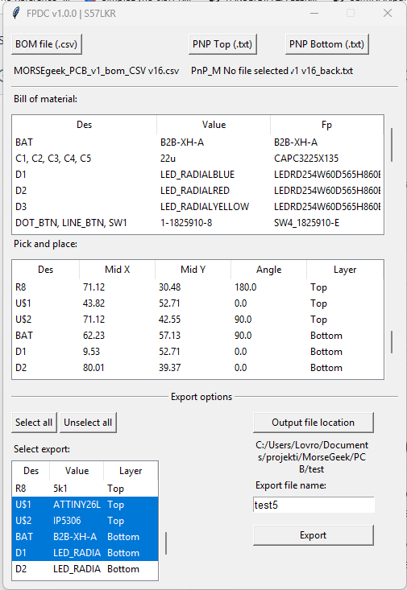

# FPDC – Fusion 360 PCB Data Converter

FPDC (Fusion 360 PCB Data Converter) is a Python application designed to convert PCB assembly data exported from Autodesk Fusion 360 into formats supported by **JLCPCB** for PCB assembly orders.

The application processes Bill of Materials (BOM) and Pick and Place (PnP) files, matches components between them, and exports the data in a format suitable for JLCPCB's assembly service.


[Schreenshot of GUI](doc/gui.png)

## Features

### 1. Pick and Place (PnP) Import

- Import PnP files for both Top and Bottom PCB layers.
- Supports `.txt` and `.csv` input files.
- Extracts the following component information:
  - Designator
  - X coordinate
  - Y coordinate
  - Rotation
  - Comment
  - Footprint
- Automatically assigns the correct PCB layer.
- Validates numerical values and skips invalid rows.

### 2. Bill of Materials (BOM) Processing

- Import BOM data exported from Autodesk Fusion 360.
- Processes component values, designators and footprints.
- Organizes component information for JLCPCB-compatible export.

### 3. Automatic BOM and PnP Matching

FPDC automatically matches components between the BOM and Pick and Place files using component designators.

Components with identical values and footprints can be grouped together.

This helps ensure that the BOM and PnP files contain consistent component references before submitting an assembly order to JLCPCB.

### 4. Component Selection

- Displays imported and matched components in tables.
- Allows users to select specific components for export.
- Provides an overview of the components included in the assembly data.

### 5. JLCPCB Export

FPDC generates Excel spreadsheets containing the processed assembly data.

**BOM Export**

The generated BOM spreadsheet contains component information such as:

- Comment
- Designator
- Footprint
- LCSC Part Number (when available)

**Pick and Place Export**

The generated PnP spreadsheet contains:

| Column | Description |
|---|---|
| Designator | Component reference |
| Mid X | Component X coordinate |
| Mid Y | Component Y coordinate |
| Layer | Top or Bottom |
| Rotation | Component rotation |
| Comment | Component value or description |
| Footprint | PCB footprint |

The exported files are intended for use with the JLCPCB PCB assembly service.

---

## Installation

### Requirements

- Python 3.10 or newer
- Tkinter
- OpenPyXL

Install the required Python package:

```bash
pip install openpyxl
```

### Run FPDC

Clone or download the repository and run:

```bash
python main.py
```

---

## How to Use

### Step 1 – Import PnP Files

1. Start FPDC.
2. Import the Top PnP file.
3. Import the Bottom PnP file, if required.
4. The imported components will appear in the PnP table.

### Step 2 – Import the BOM File

Load the BOM file exported from Autodesk Fusion 360.

### Step 3 – Match Components

FPDC matches the components from the BOM and PnP files using their designators.

The matched components are displayed in the matching table.

### Step 4 – Select Components

Select the components that should be included in the exported assembly files.

### Step 5 – Export for JLCPCB

Choose an output directory and enter a filename.

FPDC generates two Excel files:

```text
filename_BOM.xlsx
filename_PnP.xlsx
```

These files can then be used when preparing a PCB assembly order on JLCPCB.

---

## Supported PnP Input Formats

### TXT

Whitespace-separated files containing six fields per component:

```text
R1 10.5 20.5 90 Resistor R_0603
C1 15.0 25.0 180 Capacitor C_0603
U1 30.0 40.0 0 IC SOIC-8
```

### CSV

Comma-separated files:

```csv
R1,10.5,20.5,90,Resistor,R_0603
C1,15.0,25.0,180,Capacitor,C_0603
U1,30.0,40.0,0,IC,SOIC-8
```

Semicolon-separated CSV files are also supported.

---

## Project Structure

| File | Description |
|---|---|
| `main.py` | Main application window |
| `tables.py` | Table creation and management |
| `handle_pnp.py` | PnP file import and processing |
| `handle_bom.py` | BOM file import and processing |
| `find_match.py` | BOM and PnP component matching |
| `export.py` | JLCPCB assembly data export |
| `errors.py` | Error messages and notifications |

## Technologies

- Python
- Tkinter
- OpenPyXL
- CSV

## License

See the repository's license file for licensing information.
